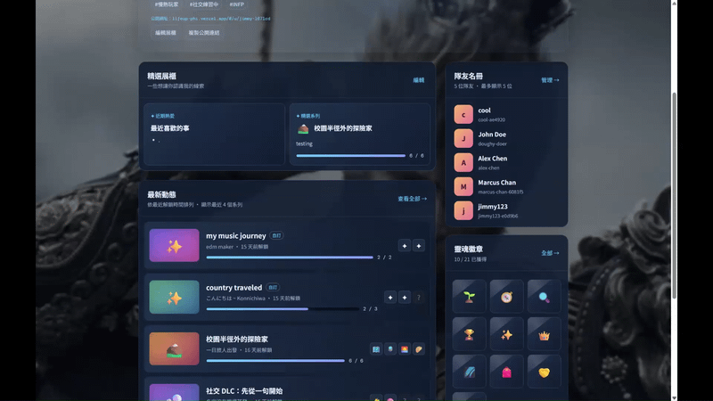

# LifeUp

**A gamified social profile that helps people find a reason to start talking.**

Starting a conversation with someone new can feel awkward when you do not know what you have in common. LifeUp is a Steam-inspired, shareable profile where people collect everyday achievements, introduce their interests, and discover common ground. Add its public link to a social bio and give a new acquaintance a few natural conversation starters.

## Product walkthrough



## Features

- **Shareable player profiles:** Public profile links, introductions, and interest tags.
- **Achievement collections:** Official achievement series plus user-created series and achievements.
- **Progression system:** Achievement XP, levels, badges, and background rewards.
- **Featured showcase:** Pin a favorite series or list current interests on the profile.
- **Friend system:** Send and respond to requests, browse a friend roster, and visit public profiles.
- **Conversation discovery:** Compare shared tags and jointly unlocked official achievements with friends.
- **Lightweight social interaction:** Encourage friends and like achievements; only the achievement owner can see the like totals.
- **Personalization and localization:** Choose owned profile backgrounds and switch between English, Traditional Chinese, and Simplified Chinese.
- **New-player guide:** A skippable, replayable interactive tour highlights real controls for profiles, achievements, rewards, sharing, and friends in the selected language. It opens after profile setup; changes saved during the tour are real.

## Tech stack

- **Frontend:** Vanilla JavaScript, HTML, and CSS; client-rendered single-page application with hash-based routing.
- **Authentication and data:** Supabase Auth and PostgreSQL.
- **Authorization:** Row Level Security for owner-scoped profile access, with database RPCs for public profiles, friendships, notifications, and background rewards.
- **Localization:** Explicit display translations for official content, with user-authored profile text left unchanged; Simplified Chinese conversion uses the locally bundled OpenCC library.
- **Tests:** Node.js built-in test runner.

## Local development

1. Create a Supabase project and configure its database by following [SUPABASE_SETUP.md](SUPABASE_SETUP.md).
2. Set up `supabase-config.js` with the project URL and **anon/publishable key**. Never put a Supabase service-role key in browser code.
3. Serve the project from its root directory:

   ```sh
   python -m http.server 4173
   ```

4. Open [http://127.0.0.1:4173/](http://127.0.0.1:4173/) in a browser.

For an existing deployment, rerun the updated `supabase/schema.sql` in the Supabase SQL Editor before using achievement likes. See the setup guide for details.

Run the automated tests with:

```sh
npm test
```

## Security and prototype scope

Public profile reads are designed to omit account email addresses. Private profile access is restricted by Row Level Security, and social actions are performed through database functions with participant and state checks.

Achievement unlocks and XP are client-calculated in this prototype, so they are not an anti-cheat system. Background redemption codes are also client-side and are not secrets or admin-only authorization. Do not use these prototype mechanics to protect paid entitlements.

## Product question

LifeUp explores whether presenting interests and personal achievements in a shareable profile can help people find common ground and initiate conversations. User testing focuses on profile creation, what topics visitors notice, and whether those topics make starting a conversation feel easier.